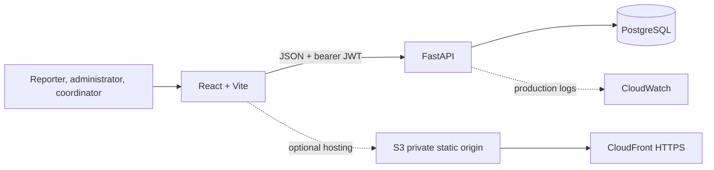

# Real-Time Disaster Emergency & Relief Coordinator

A disaster coordination workspace for an organization to record incident reports, review and verify information, assign response teams, and track relief stock. It does not contact emergency services and is not a substitute for your organization’s operational procedures.

## Features

- JWT login for reporters, coordinators, and administrators; public registration always creates a reporter account, while coordinators/admins are provisioned by admins.
- Reporter accounts can apply for coordinator access. Admins review each application, approve or decline with a recorded reason, and approval promotes the account to coordinator; an approved coordinator still needs a team assignment before dispatching.
- Incident reports with disaster type, description, map coordinates, severity, affected-person count, and a recorded status history.
- Structured urgency indicators (trapped people, urgent medical need, immediate needs) with an explainable rule-based priority recommendation; admins can set a reasoned operational priority.
- Admin incident verification, severity/type/status/location search API, dashboard counts and charts.
- Rescue team registration, coordinator assignment, availability checks, and assignment progress/completion.
- Assignment arrival and outcome notes; field completion moves an incident to `awaiting_verification`, and only an administrator can verify the outcome and resolve it.
- Admin/coordinator possible-duplicate suggestions based on incident type, approximate location, report age, and overlapping description terms; suggestions never merge or delete reports.
- Relief inventory with received/distributed stock transactions and a nonnegative stock guard.
- Leaflet / OpenStreetMap incident map, with markers colored by severity.
- PostgreSQL schema and Alembic migration, structured request logs, and database-backed health check.
- Docker Compose local setup; optional AWS deployment guide.

## Roles

| Role | Main capabilities |
|---|---|
| Reporter | Submit incidents and view only their own reports and history. |
| Administrator | Review and verify reports, create teams and coordinator accounts, manage inventory, oversee all assignments, and verify team outcomes before resolution. |
| Rescue coordinator | View verified incidents routed to the nearest K distinct coordinators, assign an available owned team with sufficient capacity, and record arrival, progress, and outcome. |

Backend authorization is applied on each protected endpoint. Anyone can create a reporter account from the **Reporter registration** screen. The registration API ignores any requested role and always creates the least-privilege reporter role. A reporter can submit a coordinator application from **Coordinator application**; an administrator reviews it in **Team access** and approves or declines it with a recorded reason. Approval changes the reporter role to coordinator. An administrator must still assign one or more response teams to that coordinator before they can dispatch them. Coordinators and administrators can also be provisioned directly by an administrator from **Team access**. Use the one-time local bootstrap command to create the first administrator. The sign-in screen offers reporter, coordinator, and administrator options and checks the account role after authentication; actual permissions are enforced by the API.

## Architecture



Locally the frontend, API, and PostgreSQL run as Docker Compose services. The API uses SQLAlchemy and Pydantic; Alembic creates/updates the schema. The client reloads API data on navigation and after writes. There is no WebSocket/background live update implementation.

## Technology

- Frontend: React, Vite, JavaScript, Tailwind CSS, React Router, Recharts, Leaflet, OpenStreetMap.
- Backend: Python 3.12+, FastAPI, SQLAlchemy 2, Pydantic, PostgreSQL, Alembic, JWT, Argon2 password hashing.
- Local operations: Docker, Docker Compose, pytest, Locust (optional load-test dependency).
- Cloud target: EC2, RDS PostgreSQL, S3 + CloudFront (or Amplify), CloudWatch.

## Repository layout

```text
backend/app/             API, SQLAlchemy models, auth, routers, development seeder
backend/alembic/         versioned database migrations
backend/tests/           API and workflow tests
backend/loadtest/        Locust load test
frontend/src/            React pages, layout, API client, map and components
infrastructure/          AWS, CloudWatch, backup and recovery guides
docs/                    architecture, schema, API and test evidence
docker-compose.yml       local frontend + API + PostgreSQL stack
IMPLEMENTATION_CHECKLIST.md phase tracking
```

## Local setup (Docker Compose)

Requirements: Docker Desktop / Docker Engine with Compose v2. The app runs locally without an AWS account. The frontend proxies API requests through its own host and port, so teammates on the same trusted network can open `http://<host-LAN-address>:5173`. Allow port 5173 in the host firewall only on that network. Do not expose the development service to the public internet; remote access requires a secured HTTPS deployment.

1. Create a local environment file only if one does not already exist, then edit both placeholders to unique random values:

   ```sh
   test -f .env || cp .env.example .env
   ```

   Keep `.env` private; it is ignored by Git. `POSTGRES_PASSWORD` and `JWT_SECRET_KEY` must be different values. Do not use the placeholders in a public deployment.

2. Build and start the services. The backend waits for PostgreSQL, applies Alembic migrations, then starts FastAPI.

   ```sh
   docker compose up --build -d
   ```

3. Create your first administrator account. The command asks for your name, email, and password in the terminal; password input is hidden and nothing is printed or saved in the repository.

   ```sh
   docker compose exec backend python -m app.create_admin
   ```

4. Open the frontend at [http://localhost:5173](http://localhost:5173), sign in with that account, and create your teammates in **Team access**. Give each teammate a unique email and initial password through a private channel; they can change it from their account screen. Add coordinators before creating response teams so you can assign a team lead.

5. Open API docs at [http://localhost:8000/docs](http://localhost:8000/docs) and health at [http://localhost:8000/health](http://localhost:8000/health). A fresh workspace starts without sample incidents or stock. The optional `app.seed_demo_data` command is for a separate development demo only; do not run it against your organization’s database.

View service logs with `docker compose logs -f`. Stop the services with `docker compose down`. The named `organization_data` volume persists. The previous local database volume with demo records is preserved separately as `cloudcomputing_postgres_data`; this setup does not delete it. To remove the local database and its records, `docker compose down -v` is destructive and should only be used when you intend to discard that data.

### Environment variables

Root `.env.example` supplies Compose values. `backend/.env.example` documents the API environment. `frontend/.env.example` sets the Vite proxy target for a direct local frontend run; Compose routes through the internal `backend` service. Vite variables are public build-time values; never place database credentials or JWT signing secrets there. CORS is an explicit comma-separated allowlist; configure exact production origins.

### Run without Docker (backend only)

Use PostgreSQL 16+ locally and Python 3.12+. Set `DATABASE_URL`, `JWT_SECRET_KEY`, `CORS_ORIGINS`, and `ENVIRONMENT=development` in your shell or `backend/.env`, then:

```sh
cd backend
python3 -m venv .venv
. .venv/bin/activate
pip install -r requirements-dev.txt
alembic upgrade head
uvicorn app.main:app --reload
```

The frontend can run separately with `cd frontend && npm ci && npm run dev` and `VITE_API_BASE_URL=http://localhost:8000`.

## Organization workflow

1. A reporter creates an account or signs in, submits an incident, and follows its status from **My reports**. Reporters cannot verify reports or view other reporters’ submissions.
2. An administrator reviews a new report and verifies it (or marks it invalid with a reason). Verification is independent of the reporter who submitted it.
3. The administrator can either create a coordinator account or review reporter applications under **Team access**. After approval, create a response team under **Rescue teams** and assign it to that coordinator.
4. After verification, the incident is ranked against available team bases using Haversine great-circle distance. Each coordinator is represented by their single closest eligible team, so multiple nearby teams owned by one coordinator count only once. The nearest `DISPATCH_TOP_K` distinct coordinators see the incident in their dispatch queue; a matched coordinator may assign any of their available teams with enough capacity. Teams without coordinates or enough people capacity cannot make a coordinator eligible. The default is 3; set `DISPATCH_TOP_K` in `.env` and restart Compose to change it. Administrators retain the full incident and assignment view.
5. The coordinator starts the assignment, records arrival, and completes it with outcome notes. The incident moves to `awaiting_verification` and becomes visible to the administrator for review.
6. An administrator reviews the outcome and resolves the incident with verification notes. The reporter sees the status history under **My reports**. Record stock received or distributed in **Relief inventory**.

### Location search and maps

Incident and team forms let you search for a place, choose a matching result, then click or drag a pin to refine the coordinates. Map tiles and place search use OpenStreetMap services with visible attribution. Place search is manual, not autocomplete; the app caches repeated queries and limits uncached requests to one per second. Search only for a geographic place name: the query is sent to the configured geocoder and should not contain incident descriptions, names, or other confidential information. The default public Nominatim service has a [usage policy](https://operations.osmfoundation.org/policies/nominatim/); for heavier or organizational production use, configure a provider you operate or a geocoding provider whose terms fit your usage by changing `GEOCODING_SEARCH_URL`.

## API and data model

The route summary is in [docs/api-documentation.md](docs/api-documentation.md); administrator account management is available under `/api/users`; the full interactive spec is at `/docs`. Tables are `users`, `incidents`, `rescue_teams`, `assignments`, `inventory`, `inventory_transactions`, and `incident_status_history`. Relationships and constraints are described in [docs/database-schema.md](docs/database-schema.md). Schema changes use Alembic; do not depend on automatic table creation for production.

Important status path: `reported → verified → assigned → in_progress → awaiting_verification → resolved`. Reporters submit; admins verify; only the nearest K distinct coordinators can see a verified incident based on each coordinator's closest eligible team. Matched coordinators can assign their own available team with sufficient capacity. The coordinator starts, records arrival, and submits outcome notes. An administrator then verifies the outcome and adds resolution notes. Reports may also be marked `invalid` with a required reason; resolved records may be closed with a reason. Status changes are recorded with actor, timestamp, and optional reason. The priority recommender is explainable decision support, not a dispatch rule. Inventory updates and assignment changes execute in database transactions. PostgreSQL row locking is used for stock/team/incident updates. SQLite integration tests validate behavior but do not provide PostgreSQL's row-lock concurrency semantics.

The operational extensions are in Alembic migrations `0004_operational_workflow` (incident urgency and verified outcomes) and `0005_coordinator_applications` (role requests and admin decisions). Upgrade an existing local database with `docker compose exec backend alembic upgrade head` (or `cd backend && alembic upgrade head` outside Compose) before running the updated API.

## Tests and verification

```sh
cd backend
pip install -r requirements-dev.txt
PYTHONPATH=. pytest -q
PYTHONPATH=. alembic upgrade head --sql > /tmp/disaster-relief-migration.sql
cd ../frontend
npm ci
npm run build
```

The test suite covers role restrictions, admin account provisioning, invalid login, incident transitions/history, urgency recommendation and required invalid-report reasons, team assignment lifecycle/capacity and outcome verification, and inventory overdraw. The current automated suite uses SQLite; it does not prove PostgreSQL concurrency. Full browser form automation was not run.

### API load experiment with Locust

Start Compose, then prepare a test environment in another terminal:

```sh
cd backend
python3 -m venv .venv
. .venv/bin/activate
pip install -r requirements-loadtest.txt
```

Run `locust -f loadtest/locustfile.py --headless -H http://localhost:8000 -u 1 -r 1 -t 15s --csv ../docs/locust-1`. Repeat with `-u 5 -r 5` and `--csv ../docs/locust-5`, then `-u 10 -r 10` and `--csv ../docs/locust-10`, keeping the host and data constant. Record requests/sec, median/p95 response time, and failures in `docs/test-results.md`. `/health` includes a database query. To include protected incident reads, set `LOADTEST_TOKEN` to a short-lived development JWT. Results from one laptop are local experiment measurements, not cloud capacity claims.

## Troubleshooting

- If Compose reports missing passwords, create `.env` from `.env.example` only when `.env` does not already exist, then replace both placeholders.
- If a port is busy, stop the other service on 5173 or 8000, or change the host-side port mapping in Compose and update `CORS_ORIGINS` / `VITE_API_BASE_URL` accordingly.
- If the API stays unhealthy, inspect `docker compose logs backend db`; wait for PostgreSQL's health check, then confirm `DATABASE_URL` and that Alembic reached `head`.
- If login fails after seeding, use the password you entered at the seed prompts. Existing seeded users are not reset by rerunning the script.
- If a citizen cannot see a report, confirm it was submitted while signed in as that citizen; citizen reports are private by design.

## Cloud computing concepts demonstrated

- **IaaS:** EC2 hosts the containerized API; students manage the OS/container lifecycle.
- **Managed data service:** RDS manages PostgreSQL operations and backup features.
- **Cloud object storage:** S3 stores static frontend build assets behind CloudFront or Amplify hosting.
- **Virtualization and containers:** Docker images package frontend/API processes and Compose connects local services.
- **Scalability and elasticity:** Containers can be replicated and EC2 capacity changed, but this prototype does not configure autoscaling or demonstrate elasticity.
- **Availability:** A single API instance is a single point of failure. RDS Multi-AZ and multiple API instances are optional future deployment improvements, not implemented here.
- **Security:** Argon2 password hashes, expiring JWTs, backend role checks, explicit CORS, private RDS guidance, HTTPS, and external secret storage.
- **Monitoring and logging:** JSON request logs and DB-aware health endpoint; AWS alarms/CloudWatch are deployment steps, not enabled in local mode.
- **Backup and recovery:** PostgreSQL volume persistence, logical dump/restore instructions, RDS snapshots and a restore drill.
- **Performance/resource utilization:** Locust experiment varies concurrency; record observed outcomes separately from expected results.

## AWS deployment

AWS is optional and no cloud resources are created by the project. Follow [the beginner deployment guide](infrastructure/aws-deployment.md), [CloudWatch notes](infrastructure/cloudwatch.md), and [backup/recovery steps](infrastructure/backup-recovery.md). Keep RDS private and restrict its security group to the backend. Use the AWS Pricing Calculator and clean up billable resources after the demo.

## Project report outline

1. Abstract and problem statement.
2. Objectives, user roles, and scope/limitations.
3. Requirements and architecture diagram.
4. Technology choices and cloud computing concepts.
5. Database schema and API design.
6. Implementation screenshots and demo workflows.
7. Test results and Locust performance experiment.
8. AWS deployment plan, security, monitoring, backup/recovery.
9. Conclusion and future work.

## Viva questions with short answers

1. **Why use RDS?** It manages common database operations such as provisioning, patching, and backups while the application still owns its schema and data model.
2. **What does EC2 demonstrate?** Infrastructure as a Service: the project controls a virtual machine and runs its backend container there.
3. **Why hash passwords with Argon2?** A slow, memory-hard one-way hash makes stolen password hashes more costly to guess than plaintext or a fast hash.
4. **Where is authorization enforced?** FastAPI dependencies check the authenticated user's database role on each protected operation; hiding a button is only a UI convenience.
5. **How is stock protected from going negative?** The API validates stock before distribution in a transaction and PostgreSQL also has a nonnegative quantity constraint.
6. **Is the prototype highly available or real-time?** No. The local flow is request/refresh based and the proposed single EC2 instance can fail; no autoscaling or WebSockets are implemented.
7. **What does the Locust test measure?** Request rate, response-time percentiles, and failures under a chosen number of simulated concurrent users on the test host.
8. **How would you recover a database?** Restore an RDS snapshot to a separate private instance, point a test backend at it, and validate health and representative records before changing production traffic.

## Operational limits

This app does not contact emergency services, deliver alerts, or validate a report against external sources. The recommendation rules and possible-duplicate matching are basic heuristics that require operator review. Your team must verify records before taking action, define its own operating procedures, and protect sensitive location and incident information. Before using it for live organizational operations, deploy behind HTTPS with restricted network access, configure backups and monitoring, and review privacy/security requirements. The local development stack is not an internet-facing production deployment. Resource reservations/requests, shelter management, persistent notifications, responder acceptance/rejection, attachment upload, offline sync, fine-grained general audit events, WebSockets, automated cloud provisioning, autoscaling, and tested multi-AZ failover are not implemented. AWS messaging/storage requires configured AWS credentials, IAM, buckets/topics, and explicit integration work; no AWS services are called by this build.
