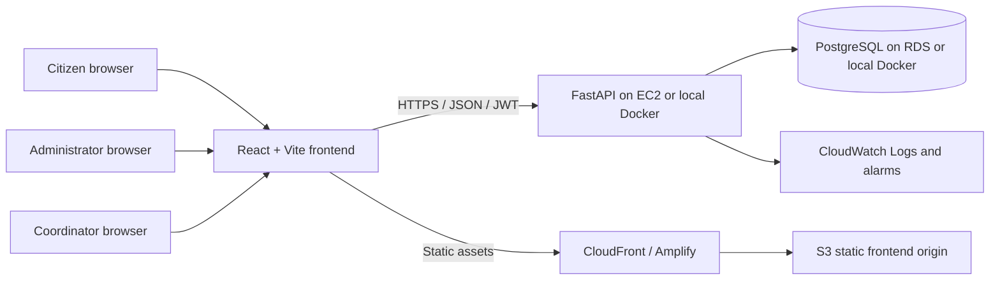

# Architecture

Local development uses the same three logical services with Docker Compose: frontend, FastAPI backend, and PostgreSQL. Alembic owns schema changes. JWT authentication and server-side role checks protect API actions. The prototype polls on page load and refreshes after user actions; it does not implement WebSockets or automatic background live updates. Simulated data is intended for academic demonstration only.
